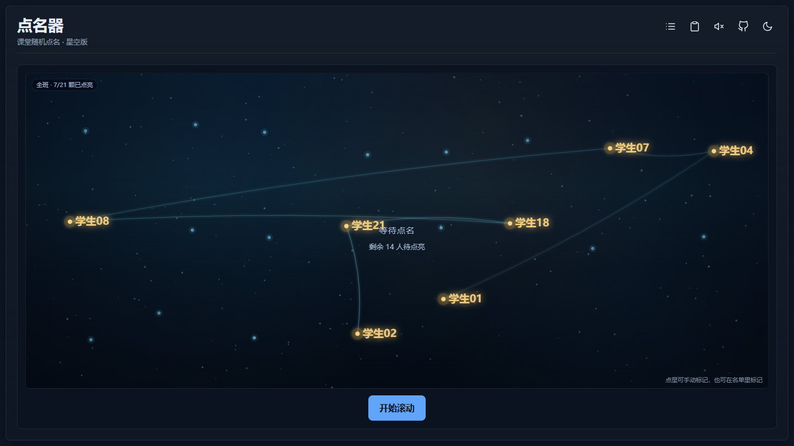

# 点名器（Rollcall）

一个可直接离线使用的课堂随机点名工具。名单是星：点名即点亮，已点的星连成星座。首屏只有一片星空和一个「开始滚动」，名单与点名记录都收进两侧抽屉，不占用投影画面。

在线体验：[点名器在线页面](https://psychelzh.github.io/rollcall/)

> 在线页面跟随仓库默认分支 `main`，每次推送后自动更新。

## 这一版的界面

| 位置 | 内容 |
| --- | --- |
| 首屏 | 整片星图 + 一个「开始滚动」按钮；名单输入框、控制按钮、已点名单都不常驻 |
| 头部「名单」按钮 | 左侧滑出抽屉：粘贴 / 编辑名单、拖入或选择文件、GitHub 导入、打乱、清空、待点名单逐人列表 |
| 头部「已点名单」按钮 | 右侧滑出抽屉：出勤总计、已点列表（逐人可改到班状态）、复制 / 导出 / 传回 / 同步 / 清除 |
| 其他头部按钮 | 抽中提示音开关（默认关闭）、白天 / 夜间主题、项目仓库 |

两个抽屉互斥，点遮罩、按 Esc 或点关闭按钮都能退出。星图始终是深空底色；白天 / 夜间主题只改变页面外壳，不改变画布。

## 名单导入

- 支持 `.txt` / `.csv` / `.tsv` 与 **`.xlsx` 点名册**，可一次选多份，也可直接粘贴姓名（每行一个，或逗号 / 分号分隔）。
- 可把文件拖进名单抽屉的虚线区，也可**直接拖到整片星图上**，不必先打开抽屉。
- CSV 自动跳过表头、识别姓名列与「班级」列，兼容 BOM、CRLF、引号与多种分隔符。
- **`.xlsx` 智能识别**：直接读取学校常用的点名册模板，自动扫描表头行（不限于第一行）、按表头文字定位「姓名 / 学号 / 班级」列、用「序号列是数字且姓名列非空」圈定名单范围，自动跳过合并抬头、说明文字、末尾统计行与空白列。抬头中的课程名称 / 教学班代码 / 授课教师会读作名单名称并显示在预览来源里；有班级列就按班级分星区。解析全程在浏览器本地完成，不引第三方库、不上传数据；老版 `.xls` 与加密工作簿不支持，会给明确提示。
- 导入前先预览人数、星区、重复项与异常行，再选「追加」或「替换」；默认保留已有点名进度。
- 也可从 GitHub 仓库读取 CSV 导入（需网络，属于用户主动发起的请求）。

**星区规则**：班级信息是可选增强，不是必填项。

| 导入时掌握的信息 | 星图表现 |
| --- | --- |
| 一次选多份名单文件（如「6班.txt」「7班.txt」） | 按文件名分星区 |
| 单个文件带「班级」列 | 按该列取值分星区 |
| 只有一个名单、没有任何班级信息 | 全班一片星空 |

学校点名册模板通常带「班级」列，`.xlsx` 导入后即按行政班分成多个星区。预览里报几个星区，确认后就是几个；工具不会因为缺班级信息而强行分组或要求补填。

## 点名与手动标记

1. 打开 `index.html`（双击即可，无需服务器与网络），或访问在线页面。
2. 点头部「名单」按钮打开左侧抽屉导入名单；也可把文件直接拖到星图上。
3. 在预览弹窗核对人数、星区、重复项与异常行，选「追加」或「替换」后确认。
4. 点「开始滚动」，再点「停止」抽取一名；出结果时姓名下方有一条「到 / 未到 / 请假」状态条，一键标记即可，不标记也不影响继续点名。
5. 需要补点时，有两条入口：**点击星图上未点亮的星**，或**在名单抽屉的「待点名单」里逐人点「标记」**。两条都走同一套抽出逻辑，同样触发点亮、庆祝与（开启后的）提示音。
6. 点头部「已点名单」按钮打开右侧抽屉，顶部是出勤总计（已点人数与三种状态各多少），列表里逐个显示并修改到班状态；也可做复制 / 导出 / 传回 / 同步 / 清除。

### 到班状态怎么记

- 三态：**到 / 未到 / 请假**，抽中时一键记，事后也能在已点名单抽屉里改；没有默认状态，没记就是没记。
- **未到 / 请假的学生仍留在抽池里**，下次还可能被抽到——记的是这次课的出勤，不是把人移出名单。
- 已点抽屉顶部的总计按当前状态实时刷新：`已点 N 人 · 到 X · 未到 Y · 请假 Z`。
- 状态跟着已点名单一起复制 / 导出 / 传回 / 同步，每行格式为 `姓名<TAB>状态`；未标记的行只有姓名，旧版本传回照样兼容。

### 星空怎么读

- 一名学生对应一颗星，位置按姓名哈希固定，点名与刷新都不会让星换位置。
- 未点是暗星；滚动时星光在星群间流转；停止时定格点亮，带辉光、涟漪与一次短暂的粒子迸发。
- 已点亮的星按点名先后连成柔和弧线，越新的段落越亮，一学期下来逐步连满。
- 已点学生的姓名直接标在各自星点旁，星图本身就是完整的点名记录。
- 大号姓名只在滚动与出结果时出现，空闲时星图保持完整可见；星点与标注大小随画布自适应，1920×1080 与 1366×768 投影下都保持可读。
- 抽中提示音由 Web Audio 即时合成（无音频文件），默认静音，点头部喇叭按钮开启。

## 已点名单的两条去路

- **传回（本地文件）**：把之前导出的 `.txt`，或一份 `.xlsx` 点名册拖进已点名单抽屉，也可点「传回」选文件。工具会跳过已存在的姓名、只补入新记录，并同步把这些人从待点名单中移除。适用于换电脑、换浏览器后续点，支持先预览再确认。
- **同步（GitHub）**：点「同步」只需填 `owner/repo` 和 PAT；文件路径、PR 标题、分支名自动生成，需要改时展开「高级设置」。仓库名会记住，PAT 只存在当前标签页的会话存储里，关闭标签页即失效，不写入 localStorage。

> 私有仓库的 PAT 需 `repo` 权限，公开仓库需 `public_repo` 权限。

## 数据与隐私

- 待点名单、已点名单、分组、当前名单名、主题保存在浏览器 `localStorage`（键 `rollcall_state_v2`）；提示音开关与到班状态各自单独存放（键 `rollcall_sound_v1` / `rollcall_attendance_v1`），不混入名单状态。
- 从旧版升级时会自动读取 `rollcall_all_names_v1` / `rollcall_called_names_v1` / `rollcall_current_list_name_v1` 并迁移，旧数据只读不删。更早版本里的「视图模式」字段会被忽略（本版没有模式切换）。
- 名单解析全部在浏览器本地完成，不上传任何学生信息；唯一的外部请求是用户主动发起的 GitHub 导入 / 同步。
- 「清空名单」「清除已点名单」不可恢复，执行前会二次确认。
- 本仓库内的界面截图使用占位姓名，不含真实学生数据。

## 技术实现

纯原生 HTML / CSS / JavaScript，无框架、无构建步骤、无外部依赖：

| 文件 | 职责 |
| --- | --- |
| `index.html` | 页面结构、内联 SVG 图标集、左右抽屉与各功能弹窗 |
| `styles.css` | 设计 Token、白天 / 夜间主题、抽屉与响应式布局、主题化滚动条 |
| `script.js` | 存储与 v1 迁移、名单解析（含 `.xlsx`）、导入预览、点名引擎、到班状态、Canvas 星图渲染、GitHub 同步 |

分层：状态与存储 → 名单解析 → 导入 / 预览 → 点名引擎 → 到班状态 → 视图渲染 → 事件绑定。

`.xlsx` 解析不引任何第三方库：直接读 ZIP 中央目录、用浏览器原生 `DecompressionStream` 解压、由 `DOMParser` 读取表格 XML，再按单元格引用还原行列。运行时不支持该能力时给明确提示，可另存为 `.csv` 导入。

- 星图用 Canvas 2D；星云、边缘柔光与辉光精灵预渲染到离屏画布，绘制期不新建渐变对象；`ResizeObserver` 跟随容器尺寸即时重排。
- 图标是一套内联 SVG 描边图标，不使用 emoji 作为功能图标。
- 颜色全部通过 CSS 变量引用，Canvas 也从同一套 Token 取色；新增色值只落在 Token 定义区。
- 支持 `prefers-reduced-motion`：开启系统「减少动态效果」后，星云保持静态，流星、视差、粒子迸发与连线渐显全部关闭，只保留一次静态高亮。
- 桌面端页面撑满视口高度，星图独占主区；窄屏改为纵向滚动布局，抽屉转为全宽。
- 开发过程中的静态检查与浏览器端到端用例保存在本地 `.workbuddy/`（已忽略，不入库）。

## 二次部署（可选）

Fork 本仓库后在仓库设置里启用 Pages 即可，无构建产物；也可直接把三个文件复制到任意静态托管。

## 许可协议

Apache License 2.0。欢迎自由使用、修改和分发，但请遵守相关条款。

## AI 使用说明

本项目在开发过程中使用了 AI 辅助（包括代码生成、重构建议与文档优化），并在迭代中持续调整。当前代码与文档已包含多轮 AI 协作结果，同时由维护者进行审阅、验证与取舍。

说明：AI 参与不代表功能天然正确，仍建议在实际使用前结合你的场景进行验证。
